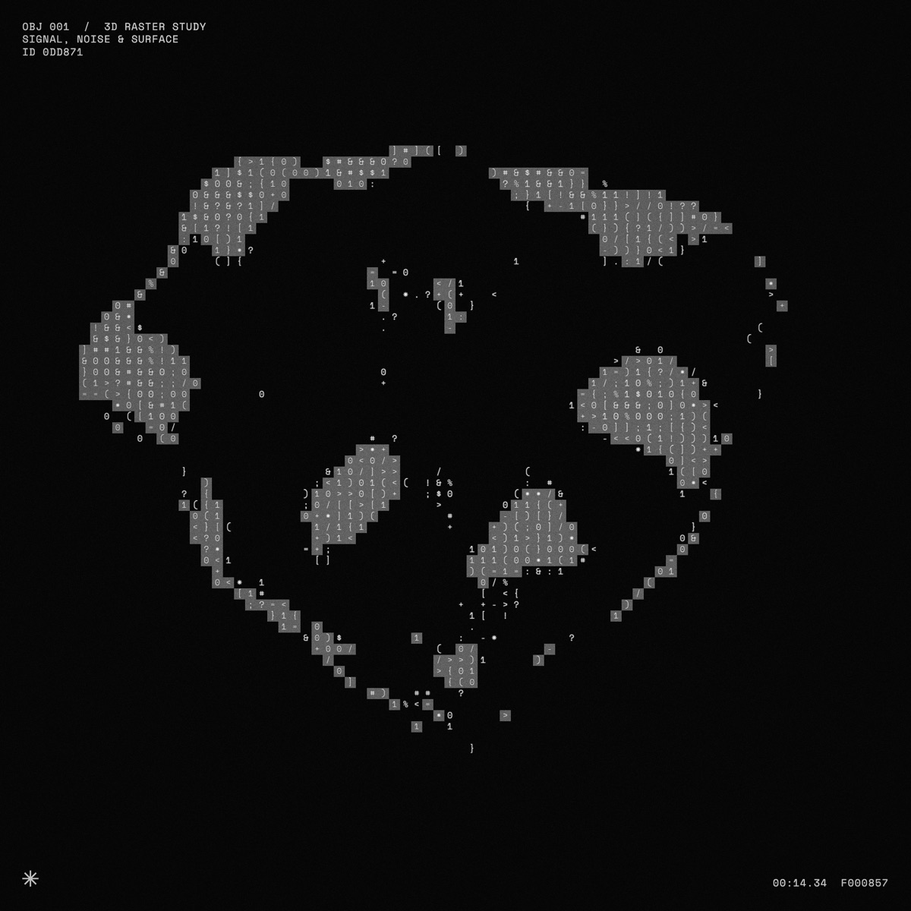
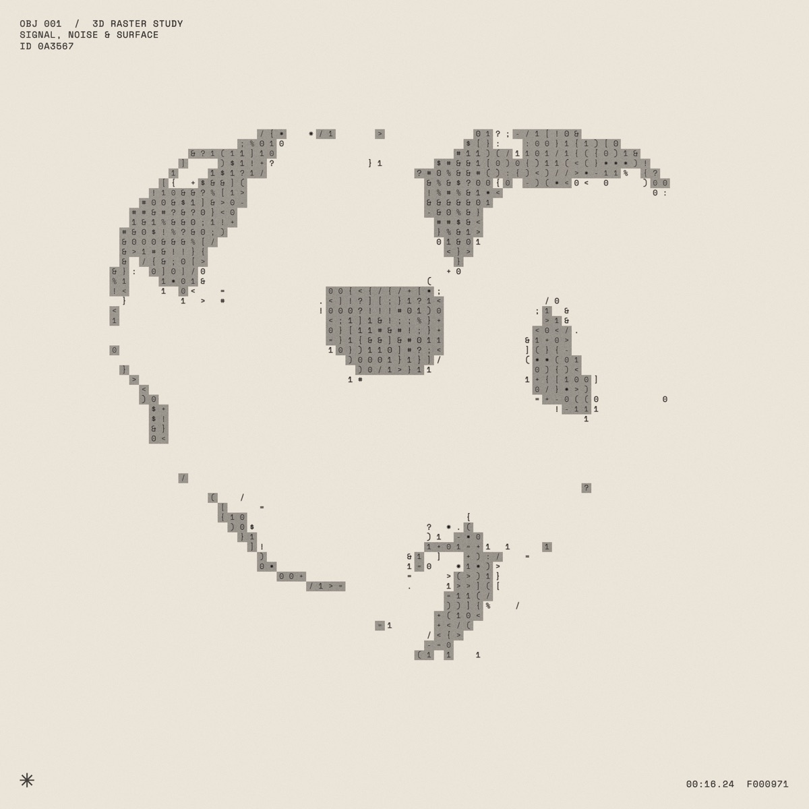
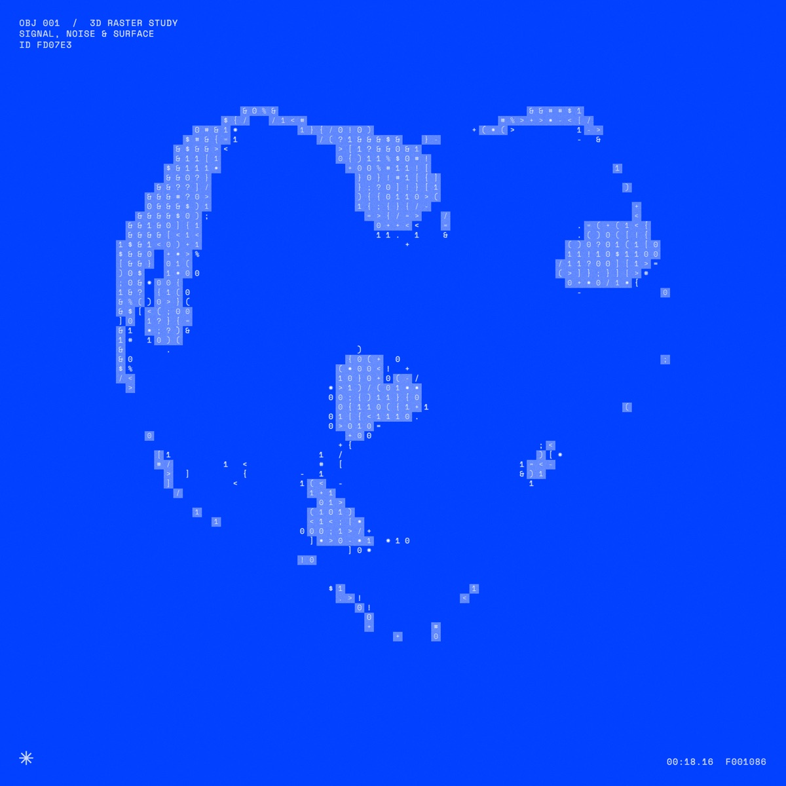

# halftone.gl

> **⚠️ Experimental.** This is a personal playground, not a finished product. Expect rough edges, missing polish and settings that change or disappear between versions.

halftone.gl is a real-time halftone and ASCII renderer for 3D icons, running in the browser. A soft 3D icon slowly turns in the middle of a square canvas, and two WebGL shader passes redraw it as dots, halftone screens, code characters or grainy tiles. Every parameter is live on a slider, so you can play until something looks good and export it as a PNG or a short video.

<p>
  
  
  
</p>

<sub>The same heart with the same settings (the Tiles look) in the Dark, Print and Blueprint palettes.</sub>

## What you can do

- **Pick an object.** 13 soft, rounded 3D icons: padlock, music note, heart, star, lightning, play, plus, speech bubble, gear, cloud, key, microphone and headphones. The object always sits in the centre and rotates.
- **Pick a raster.** Draw the object with characters (binary `0 1`, code symbols, hex, math, arrows, matrix-style katakana, letters) or with plain marks (dots, squares, diamonds, plus signs, rings, bars).
- **Shape the surface.** Displace and twist the object with noise, add fingerprint, topographic, stripe, spot or cloud patterns, and move the light.
- **Add texture.** Grainy blobs under the raster, grey tiles behind each character, stray symbols around the edges, glow and flicker.
- **Switch palettes.** Dark, Print (ink on cream) and Blueprint (white on `#0040FF`). Every look works in every palette.
- **Start from a look.** Signal, Scanner, Topo, Halftone, Code and Tiles are presets; **Randomize** (or the `R` key) rolls a new combination.
- **Export.** Save a PNG (`S` key) or record a 6-second video. The canvas is always square, so exports are too.

## Getting started

You need [Node.js](https://nodejs.org) 20.19 or newer.

```bash
git clone https://github.com/robertvklinken/halftone.gl.git
cd halftone.gl
npm install
npm run dev
```

Then open the address it prints, usually <http://localhost:5173>.

Drag to orbit, scroll to zoom. All the settings live in the panel on the right.

## Saving variations

The panel is built with [DialKit](https://www.dialkit.dev/), which has versions built in:

- Open the version menu at the top of the panel and choose **New version** to save what you see.
- Pick a saved version from the same menu to get it back.
- While a saved version is selected, slider changes are saved into it. Randomize and the Looks buttons step back to the scratch version first, so they never overwrite a saved one.
- The clipboard button copies all current values as text, which is handy as a backup or for sharing a look.

Versions are stored in your browser only (local storage). They don't sync between browsers, and because this is experimental, a future change can make an old version look different or reset some of its settings.

## How it works

Each frame is drawn in two WebGL passes, both written in GLSL:

1. **Object pass.** The icon is rendered with a custom shader into an off-screen buffer. The vertex shader bends the mesh with 3D simplex noise; the fragment shader adds lighting, rim light and the surface pattern. It outputs brightness only, no colour.
2. **Raster pass.** A full-screen shader reads that brightness and, for every cell of a screen-space grid, decides what to draw: a dot sized by brightness, or a character picked from a glyph atlas. Blobs, tiles, grain, vignette, overlay text and the palette colours are mixed in here.

The overlay text and the glyph atlas are drawn with a regular 2D canvas and handed to the raster shader as textures, which is why they show up in exports.

The icons are built in code from three.js primitives: rounded extrusions, tubes and spheres, merged and subdivided so the noise displacement has enough vertices to work with.

```
src/
  App.jsx            control panel definition (DialKit) and wiring
  looks.js           presets and Randomize
  engine/
    Engine.js        three.js setup, render loop, export and recording
    shaders.js       all GLSL: object pass and raster pass
    icons.js         the 3D icon geometry
    overlay.js       corner text, timecode, asterisk, tracking boxes
```

## Known limitations

- Mostly tried in Chromium-based browsers on macOS. Other browsers should work but haven't been tested much.
- Video recording uses the browser's `MediaRecorder`, so you get MP4 or WebM depending on the browser.
- Export resolution follows your window size and screen density; a bigger window gives a bigger export.
- No mobile layout for the panel.

## Built with

[three.js](https://threejs.org) · [DialKit](https://www.dialkit.dev/) · [React](https://react.dev) · [Vite](https://vite.dev) · [Space Mono](https://fonts.google.com/specimen/Space+Mono)
